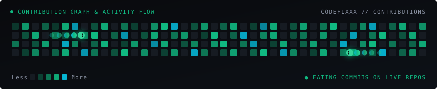

<div align="center">
  <a href="https://portfolio-ayush-mishra.vercel.app/" target="_blank">
    
  </a>

  <p align="center">
    <a href="https://github.com/codefixxx">
      
    </a>
  </p>

  <p align="center">
    <a href="https://portfolio-ayush-mishra.vercel.app/" target="_blank">
      
    </a>
    &nbsp;
    <a href="https://www.linkedin.com/in/ayush-mishra-2072961a3/" target="_blank">
      
    </a>
    &nbsp;
    <a href="mailto:ayushkmishra332@gmail.com">
      
    </a>
    &nbsp;
    <a href="https://github.com/codefixxx">
      
    </a>
  </p>
</div>

---

### `01 // EXECUTIVE PROFILE`

I am an **AI Engineer & Systems Builder** pursuing a **B.Tech in Mathematics & Computing** at the **Central University of Karnataka**. My engineering philosophy bridges theoretical mathematical rigor—spanning linear algebra, discrete graph theory, and numerical optimization—with the architecture of resilient, production-grade distributed software.

```
┌─────────────────────────────────┬────────────────────────────────────────────────────────┐
│ DISCIPLINARY FOCUS              │ Distributed AI · Real-Time Systems · Cloud Native      │
│ MATHEMATICAL FOUNDATION         │ Optimization Theory · Linear Algebra · Graph Topology  │
│ PRODUCTION STANDARDS            │ Idempotent Pipelines · Chaos Resilience · Strict Typing│
│ ENGAGEMENT STATUS               │ Open to AI Engineer & High-Scale Systems Appointments │
│ GEOGRAPHIC ANCHOR               │ India // Remote Distributed Infrastructure             │
└─────────────────────────────────┴────────────────────────────────────────────────────────┘
```

#### Core Engineering Principles
- **Algorithmic Determinism:** Leveraging mathematical structures and graph representations to model complex application state, dependency graphs, and multi-agent coordination.
- **Latency-Critical Design:** Constructing sub-second streaming pipelines with WebSockets, WebRTC, and Server-Sent Events (SSE) backed by in-memory caching and non-blocking asynchronous runtimes.
- **Verification-First Mindset:** Enforcing reliability through automated regression suites, chaos testing scenarios, and end-to-end integration verifications prior to production deployment.

---

### `02 // OPEN SOURCE ENGINEERING & UPSTREAM IMPACT`

My open-source work is dedicated to building scalable platforms, contributing to cloud-native foundations, and developing resilient developer tooling.

<table>
  <tr>
    <td width="50%" valign="top">
      <h4>
        <a href="https://github.com/codefixxx/tenali">Tenali — Adaptive Math Platform</a>
      </h4>
      <p><b>Focus:</b> Topological Learning Paths & Centralized AST Math Parsing</p>
      <ul>
        <li><b>DAG Architecture:</b> Formulated directed acyclic graph (DAG) topological sorting across 90+ interactive learning modules with adaptive mastery progression.</li>
        <li><b>Non-Invasive Telemetry:</b> Engineered an event-driven telemetry layer across disparate micro-applications without altering underlying legacy APIs.</li>
        <li><b>Mathematical Parser:</b> Built a zero-dependency parser and validation engine (supporting complex fractions, mixed numbers, scientific notation, and coordinate geometry) with extensive <b>Vitest</b> coverage.</li>
      </ul>
      <p>
        
        
        
        
      </p>
    </td>
    <td width="50%" valign="top">
      <h4>
        <a href="https://github.com/codefixxx/kpt">kpt & Porch (Kubernetes Automation)</a>
      </h4>
      <p><b>Focus:</b> Declarative Configuration Orchestration & Cloud Native APIs</p>
      <ul>
        <li><b>Upstream Engineering:</b> Contributed to declarative Kubernetes package orchestration and automated configuration manipulation within the Google / kptdev ecosystem.</li>
        <li><b>Controller Logic:</b> Engaged with <code>porchctl</code> package lifecycle operations and repository synchronizers.</li>
        <li><b>Verification:</b> Upheld strict cloud-native testing conventions, SonarCloud static analysis standards, and DCO compliance.</li>
      </ul>
      <p>
        
        
        
      </p>
    </td>
  </tr>
  <tr>
    <td width="50%" valign="top">
      <h4>
        <a href="https://github.com/codefixxx/grafana-pathfinder-app">Grafana Pathfinder</a>
      </h4>
      <p><b>Focus:</b> In-App Interactive Learning & Contextual Telemetry</p>
      <ul>
        <li>Contributed to Grafana's official interactive learning app plugin, embedding contextual documentation directly into telemetry dashboards.</li>
        <li>Streamlined guided learning tours and interactive developer assistance without workflow context switching.</li>
      </ul>
      <p>
        
        
      </p>
    </td>
    <td width="50%" valign="top">
      <h4>
        <a href="https://github.com/codefixxx/vi-slides">Vi-Slides (VLED Lab)</a>
      </h4>
      <p><b>Focus:</b> Real-Time State Sync & Classroom AI Q&A</p>
      <ul>
        <li>Engineered a TypeScript Express backend implementing clean repository patterns and dependency injection.</li>
        <li>Delivered real-time multi-client slide synchronization via Socket.io and integrated Google Generative AI for automated student Q&A.</li>
      </ul>
      <p>
        
        
        
      </p>
    </td>
  </tr>
</table>

---

### `03 // VISUAL ANALYTICS, CHARTS & METRICS`

<div align="center">
  <p><b>🐍 Real-Time Contribution Grid & Kinetic Activity Stream</b></p>
  <picture>
    <source media="(prefers-color-scheme: dark)" srcset="https://raw.githubusercontent.com/codefixxx/codefixxx/output/github-contribution-grid-snake-dark.svg" />
    <source media="(prefers-color-scheme: light)" srcset="https://raw.githubusercontent.com/codefixxx/codefixxx/output/github-contribution-grid-snake.svg" />
    
  </picture>
</div>

<br/>

<div align="center">
  <a href="https://github.com/codefixxx">
    
  </a>
  <a href="https://github.com/codefixxx">
    
  </a>
</div>

<br/>

<div align="center">
  <a href="https://github.com/codefixxx">
    
  </a>
  <a href="https://github.com/codefixxx">
    
  </a>
</div>

<br/>

<div align="center">
  <a href="https://github.com/codefixxx">
    
  </a>
  <a href="https://github.com/codefixxx">
    
  </a>
</div>

---

### `04 // TECHNICAL ARSENAL`

<div align="left">

#### 🔹 Core Languages & Computing Foundations
<p>
  
</p>

#### 🔹 Artificial Intelligence, Machine Learning & Vision
<p>
  
</p>
<p>
  
  
  
  
</p>

#### 🔹 Backend Systems, Datastores & Cloud Infrastructure
<p>
  
</p>
<p>
  
  
  
  
</p>

#### 🔹 Frontend Architecture & Creative Development
<p>
  
</p>
<p>
  
  
  
</p>

#### 🔹 Reliability, Testing & Tooling
<p>
  
</p>
<p>
  
  
  
  
</p>

</div>

---

### `05 // PRODUCTION SYSTEMS DOSSIER`

<table>
  <tr>
    <td width="50%" valign="top">
      <h4><a href="https://github.com/codefixxx/Multiagent_Research_Assistant">Multiagent Research Assistant</a></h4>
      <p>Production distributed multi-agent research workflow coordinating 5 specialized agents via parallel fan-out/fan-in graph execution.</p>
      <ul>
        <li><b>Latency Optimization:</b> Parallelized multi-source inquiry completed in <code>&lt;30s</code> (-70% execution duration).</li>
        <li><b>Fault Tolerance:</b> Redis state checkpointers with <code>0.5ms</code> idempotency cache; validated under automated chaos testing.</li>
        <li><b>Hallucination Prevention:</b> Automated Citation Validator & RAG Scorer verifying claim provenance against retrieved source chunks.</li>
        <li><b>Security:</b> AES-256-GCM encryption for BYOK credentials with in-memory zeroization; <b>202 automated tests</b>.</li>
      </ul>
      <p>
        <a href="https://multiagent-research-assistant-wmli.onrender.com/dashboard"><b>Live Dashboard ↗</b></a> &nbsp;·&nbsp;
        <a href="https://github.com/codefixxx/Multiagent_Research_Assistant"><b>System Repository ↗</b></a>
      </p>
    </td>
    <td width="50%" valign="top">
      <h4><a href="https://github.com/codefixxx/Pothole_map">PotholeMap</a></h4>
      <p>Full-stack civic-tech infrastructure linking citizens with municipal authorities through spatial computing and background queues.</p>
      <ul>
        <li><b>Spatial Intelligence:</b> PostGIS geographic routing combined with <code>512-dim</code> embedding duplicate clustering.</li>
        <li><b>Access Governance:</b> 4-role RBAC controlling a 5-stage ticket lifecycle with immutable audit trails.</li>
        <li><b>Asynchronous Processing:</b> Redis + BullMQ workers processing image compression, spatial indexation, and alerts.</li>
        <li><b>Load Resilience:</b> Verified under k6 load suites from <code>0 → 150 VUs</code> and sustained <code>30-VU</code> soak tests.</li>
      </ul>
      <p>
        <a href="https://pothole-map-one.vercel.app/"><b>Live Platform ↗</b></a> &nbsp;·&nbsp;
        <a href="https://github.com/codefixxx/Pothole_map"><b>System Repository ↗</b></a>
      </p>
    </td>
  </tr>
</table>

---

### `06 // TRANSMISSION & NETWORK`

<p align="center">
  <a href="https://portfolio-ayush-mishra.vercel.app/" target="_blank">
    
  </a>
  &nbsp;
  <a href="https://www.linkedin.com/in/ayush-mishra-2072961a3/" target="_blank">
    
  </a>
  &nbsp;
  <a href="mailto:ayushkmishra332@gmail.com">
    
  </a>
</p>

<p align="center">
  <sub><code>SYSTEM DOSSIER // AYUSH MISHRA // MATHEMATICS &amp; COMPUTING // 28.6139° N, 77.2090° E</code></sub>
</p>
